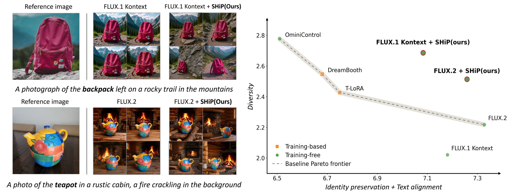

# Identifying and Mitigating Diversity Collapse in Zero-Shot Personalization with I2I Editing Models

Uichan Lee\*, Jongeon Baek\*, Sangheum Hwang†

<p align="center">
  
</p>

## 📌 Abstract

Reference-conditioned image-to-image (I2I) editing models provide a promising zero-shot approach to personalized image generation by jointly conditioning on a reference image and a text prompt. We show that recent I2I editing models, including FLUX.1 Kontext and FLUX.2, achieve strong subject identity preservation and prompt alignment, but exhibit seed-wise diversity collapse: under the same reference image and prompt, different random seeds often produce highly similar outputs. We further find that this collapse is associated with over-alignment of latent-token trajectories during denoising. Based on this observation, we introduce Selective Hidden Perturbation (SHiP), a training-free inference-time intervention that perturbs only the attention-output representations of latent tokens during early denoising while keeping reference-image and text tokens unchanged. Across diverse subjects and prompts, SHiP improves seed-wise diversity on both FLUX.1 Kontext and FLUX.2 while largely preserving identity and prompt fidelity. On FLUX.1 Kontext, SHiP increases Vendi Score from 1.547 to 2.066 and LPIPS from 0.475 to 0.621, with only minor decreases in GPT-ID and GPT-Text. A blinded human study further supports gains in perceptually meaningful diversity and a preference for SHiP-generated outputs. Additional experiments on Qwen-Image-Edit and FireRed-Image-Edit show that SHiP's diversity gains extend beyond FLUX-based models.

## Environment Setup

```bash
git clone https://github.com/daintlab/SHiP.git
cd SHiP
conda env create -f environment.yml
conda activate ship
huggingface-cli login   # FLUX.1 Kontext [dev] and FLUX.2 [dev] are gated models
```

## 📂 Models and Datasets

### Models

- FLUX.1 Kontext: [black-forest-labs/FLUX.1-Kontext-dev](https://huggingface.co/black-forest-labs/FLUX.1-Kontext-dev)
- FLUX.2: [black-forest-labs/FLUX.2-dev](https://huggingface.co/black-forest-labs/FLUX.2-dev)
- Qwen-Image-Edit: [Qwen/Qwen-Image-Edit-2511](https://huggingface.co/Qwen/Qwen-Image-Edit-2511)
- FireRed-Image-Edit: [FireRedTeam/FireRed-Image-Edit-1.0](https://huggingface.co/FireRedTeam/FireRed-Image-Edit-1.0)

### Datasets

`data/` contains the benchmark used in the paper: 15 subjects from [DreamBooth](https://github.com/google/dreambooth) and [Textual Inversion](https://github.com/rinongal/textual_inversion), each with 9 prompts from [DreamBench++](https://github.com/yuangpeng/dreambench_plus).

```text
data/
├── subject/<subject>/0.jpg   # reference image
└── prompts/<subject>.txt     # one prompt per line
```

## ⚙️ Configuration

All settings are in `config.yml`, and the defaults reproduce the paper. Set `OUT_ROOT` for each model, and run commands from the repository root.

SHiP options are under `SHIP` in each model section:

```yaml
SHIP:
  ENABLED: true            # true, false
  SITE: attn_out           # attn_out, mlp_out, block_input, block_output
  SELECTED_TOKEN: target   # target, ref, text
  NOISE:
    MODE: block_relative_std  # block_relative_std, absolute
    STD: 3.0                  # noise scale (lambda)
  EARLY_STEPS: 3           # number of perturbed denoising steps (k)
  START_STEP: 0            # first perturbed denoising step
```

## 🔥 Inference

### 1. FLUX.1 Kontext

```bash
python models/kontext/inference.py --config config.yml
```

### 2. FLUX.2

```bash
CUDA_VISIBLE_DEVICES=0,1 python models/flux2/inference.py --config config.yml --rank 0 --world_size 1
```

### 3. Qwen-Image-Edit / FireRed-Image-Edit

```bash
python models/qwen_image_edit/inference.py --config config.yml
python models/firered/inference.py --config config.yml
```

## 📊 Evaluation

Evaluation settings are in the `eval` section of `config.yml`:

```yaml
eval:
  SRC_IMAGE_ROOT: data/subject
  PROMPT_ROOT: data/prompts
  REF_IMAGE_NAME: 0.jpg
  OUT_ROOT: /result/kontext   # generated images to evaluate; metrics.json is saved here
```

```bash
python eval/metrics.py --config config.yml
```

This reports Vendi and LPIPS (plus CLIP-I, DINO and CLIP-T). GPT-ID and GPT-Text follow the [DreamBench++](https://github.com/yuangpeng/dreambench_plus) protocol with GPT-5-mini.

## License

The code is released under the MIT License. Model weights and data follow their own licenses; FLUX.1 Kontext [dev] and FLUX.2 [dev] are under the FLUX.1 [dev] Non-Commercial License.

## Citation

```bibtex
@inproceedings{lee2026identifying,
  title     = {Identifying and Mitigating Diversity Collapse in Zero-Shot Personalization with I2I Editing Models},
  author    = {Lee, Uichan and Baek, Jongeon and Hwang, Sangheum},
  booktitle = {Advances in Neural Information Processing Systems (NeurIPS)},
  year      = {2026}
}
```
